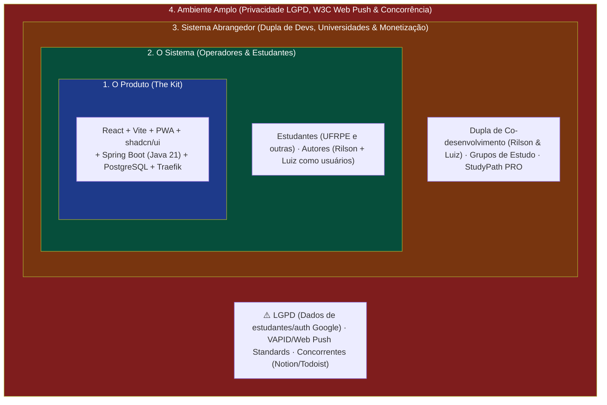
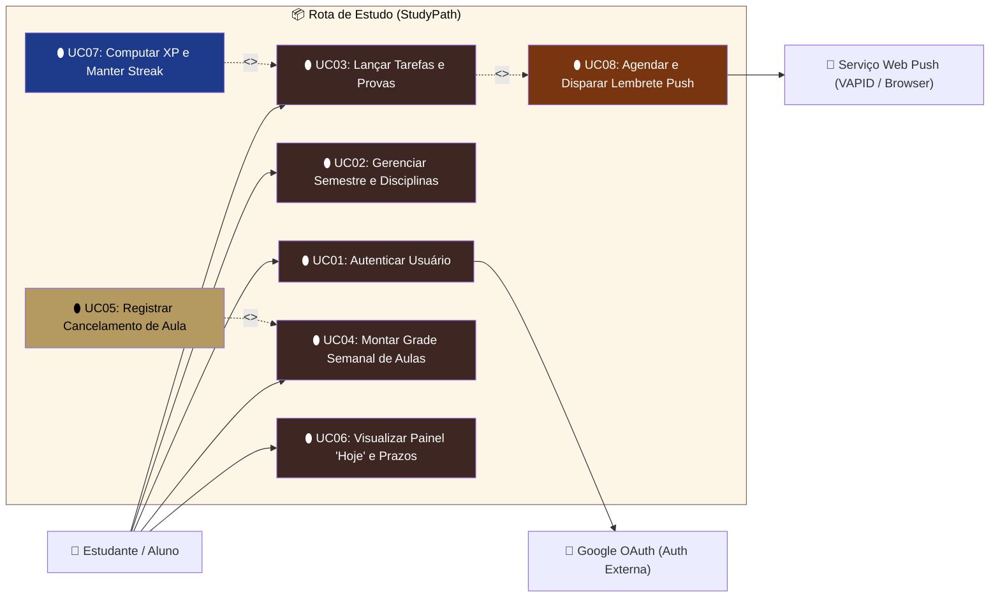

# Rota de Estudo (StudyPath)

Agenda acadêmica **web-first** para organizar o semestre do estudante: horários de aula, prazos de entrega, datas de prova, calendário com colisões, notificações (web push) e uma gamificação leve de recompensas. Mobile via PWA no início; app nativo fica arquivado como expansão futura.

> **Dupla:** Rilson Joás + Luiz · **Nome internacional:** StudyPath (i18n PT→EN desde o V1 — ver ADR-0003)

## Stack

| Camada | Escolha | Por quê |
|---|---|---|
| **Frontend** | Vite + React + TypeScript + Tailwind + shadcn/ui + PWA | app autenticado (SEO irrelevante), push via service worker, sem conflito SSR/auth (ADR-0002) |
| **Backend** | Spring Boot (Java 21) + JPA + Flyway; Spring Security na Fase 1 | 2ª língua de mercado do autor; caso real de Web/Java para portfólio (ADR-0001) |
| **Banco** | PostgreSQL | padrão consolidado do autor |
| **Infra** | Docker Compose · VPS Hetzner · Traefik · Sentry · Uptime Kuma | self-host, observabilidade |

## Roadmap

- [x] **Fase 0 — Setup:** monorepo; Contrato de API desenhado; Postgres via Compose; testes locais (Vitest/Playwright no front, JUnit/Mockito no api).
- [ ] **Fase 1 — Core:** `usuario` + auth por e-mail/senha (cookie httpOnly, refresh rotativo); `periodo` (aberto/arquivado pelo aluno); `disciplina`; CRUD `tarefa`/`prova`; grade-tipo semanal + cancelamento por instância; telas **Hoje / Semana / Mês** (mobile-first).
- [ ] **Fase 2 — Push:** VAPID web push; job cron no Spring (tarefa 24h antes; prova em cascata 7-3-1); preferências por evento; cancelamento silencia o lembrete; login com Google (RF13), depois de entrar no contrato OpenAPI.
- [ ] **Fase 3 — Gamificação:** módulo desacoplado (eventos de domínio → XP/nível/streak/conquistas); só recompensa no V1, punição como ponto de extensão.
- [ ] **Fase 4 — Profissionalizar:** checklist de engenharia (P0–P9), Sentry, acessibilidade, i18n EN, deploy Traefik, monitoramento e docs.

> A cada fase: testes primeiro, convenções do padrão de engenharia, validação com o parceiro.

## Estado da Fase 0

- Contrato de integração em [`docs/openapi.yaml`](docs/openapi.yaml), com as convenções resumidas em [`docs/api.md`](docs/api.md) e tipos gerados em `front/src/lib/api.generated.ts`.
- API Spring Boot 21 com Actuator, Flyway, JPA, PostgreSQL, migration inicial do domínio e health check em `GET /api/v1/health`.
- Front Vite + React + TypeScript com shell mobile-first, rotas Hoje/Semana/Mês, dicionário pt-BR/en, base shadcn/ui e conexão com a API.
- Docker Compose com `db`, `rota-estudo-api` e `rota-estudo-front`; Nginx faz o proxy de `/api` no serviço do frontend.
- Esqueleto de produção documentado no repositório `hetzner-infra`; o banco final será o `rota_de_estudo_db` no Postgres compartilhado da VPS.
- CRUD, autenticação, push, gamificação e PWA continuam nas fases seguintes.

## Desenvolvimento local

```bash
cp .env.example .env
cp front/.env.example front/.env.local
docker compose up --build
```

A API fica em `http://localhost:8080`, o frontend em `http://localhost:8081`, o Swagger em `http://localhost:8080/swagger-ui.html` e o PostgreSQL em `localhost:5432`. Se alguma porta já estiver ocupada, altere `API_PORT`, `FRONT_PORT` ou `DB_PORT` no `.env` antes de iniciar.

Para o frontend em modo iterativo:

```bash
cd front
npm install
npm run dev
```

Os testes da API e do frontend são executados localmente; o Playwright exige os navegadores do Playwright instalados no ambiente.

Para validar a base inteira:

```bash
bash scripts/preflight.sh
bash scripts/verify.sh
```

## Documentação e operação

- [`docs/engineering.md`](docs/engineering.md) — alinhamento com P0–P9 e lacunas de produção.
- [`docs/pre-meeting.md`](docs/pre-meeting.md) — o que já está pronto e o que a reunião precisa decidir.
- [`docs/reuniao-luiz.md`](docs/reuniao-luiz.md) — briefing curto para apresentar o projeto ao parceiro.
- [`docs/design.md`](docs/design.md) — shadcn/ui, tokens e decisão de não herança do Design Narniano.
- [`hetzner-infra/rota-de-estudo/README.md`](../hetzner-infra/rota-de-estudo/README.md) — topologia de produção, provisionamento e ordem de deploy.
- [`docs/adr/0005-shared-postgres.md`](docs/adr/0005-shared-postgres.md) — decisão do banco compartilhado e seus limites.

## Decisões de arquitetura

Registradas como ADRs em [`docs/adr/`](docs/adr/):

| ADR | Decisão | Motivo central |
|---|---|---|
| [ADR-0001](docs/adr/0001-backend-spring-boot.md) | Backend em **Spring Boot** (não Fastify/TS nem Laravel) | dominar Java/mercado enterprise; Laravel já dominada no Assídua |
| [ADR-0002](docs/adr/0002-frontend-vite-react.md) | Frontend em **Vite + React** (não Next.js) | app autenticado, PWA + push; SEO fora de escopo |
| [ADR-0003](docs/adr/0003-internacionalizacao.md) | **i18n desde o V1**; nome duplo Rota de Estudo/StudyPath | porta do inglês aberta, zero texto hardcoded |
| [ADR-0004](docs/adr/0004-shadcn-visual-direction.md) | shadcn/ui como base de componentes, sem herança do Design Narniano | ferramenta de dados precisa de clareza, não ornamento devocional |
| [ADR-0005](docs/adr/0005-shared-postgres.md) | PostgreSQL compartilhado na VPS Hetzner | economiza RAM; exige backup, monitoramento e limite explícito de disponibilidade |

## Domínio (glossário)

Ver [`CONTEXT.md`](CONTEXT.md). Eixos: `usuario` (dono dos dados, contas 100% individuais) → `periodo` (topo, manual) → `disciplina` (central) → `tarefa` (com tipo TAREFA/TRABALHO) · `prova` (nota opcional) · `horario` (grade-tipo) · `cancelamento` (exceção por instância) · `config_notificacao` · módulo `gamificacao`.

## Estrutura

```
rota-de-estudo/
├── api/            # Spring Boot (REST + auth + jobs push)
├── front/          # Vite + React + shadcn/ui (PWA)
├── docs/adr/       # decisões de arquitetura
├── docs/api.md     # contrato de API (Fase 0)
├── docs/engineering.md # alinhamento com P0–P9
├── docs/reuniao-luiz.md # briefing da reunião
├── scripts/        # preflight e verificação
├── CONTEXT.md      # glossário do domínio
└── docker-compose.yml
```

## Modelo Cebola (Mapeamento de Stakeholders)



* **1. O Produto (*The Kit*):** Frontend Vite + React + shadcn/ui (PWA), backend enterprise em Spring Boot com Spring Security e Flyway, banco PostgreSQL e proxy Traefik na Hetzner.
* **2. O Sistema (*Our System*):** Estudantes universitários organizando semestres caóticos (prazos de entrega, datas de provas, cancelamentos de aula e gamificação por XP/streak) e os autores operando o app no dia a dia.
* **3. O Sistema Abrangedor (*The Containing System*):** A parceria da dupla (Rilson e Luiz compartilhando o projeto no portfólio profissional), grupos acadêmicos que compartilham grades e potenciais planos premium no modelo internacional (*StudyPath*).
* **4. O Ambiente Amplo (*The Wider Environment*):** **LGPD e Privacidade** (armazenamento seguro de e-mails, autenticação OAuth Google), padrões de **Web Push/VAPID** dos navegadores (Chrome, Safari, Firefox) e registro de marca nas lojas (*Rota de Estudo* / *StudyPath*).

## Requisitos do Sistema

Conforme as boas práticas de Engenharia de Software: **Requisitos Funcionais (RF)** expressam comportamento observável (*O Verbo*), enquanto **Requisitos Não-Funcionais (RNF)** expressam qualidades e restrições arquiteturais (*O Advérbio* / ISO 25010).

### Requisitos Funcionais (RF — O Verbo)

Priorizados por dependência e relevância: **P1** é a fatia vertical que já resolve o problema de ponta a ponta; **P2** completa a agenda; **P3** depende de dados reais ou de integração externa. RF10–RF13 detalham itens que antes estavam agrupados em RF01 e RF09.

| Prior. | RF | Requisito | Depende de |
|---|---|---|---|
| P1 | RF01 | **Autenticar** o usuário com e-mail e senha (cadastro, login, logout; cookie httpOnly com refresh rotativo). | — |
| P1 | RF02 | **Cadastrar e gerenciar** períodos acadêmicos (semestres) e disciplinas. | RF01 |
| P1 | RF03 | **Lançar e concluir** tarefas com tipo (Tarefa, Trabalho, Outro), prioridade (Baixa, Média, Alta), prazo e tags. | RF02 |
| P1 | RF10 | **Exibir** o painel Hoje: o que vence hoje e nos próximos dias, provas com contagem e progresso. | RF03 |
| P2 | RF04 | **Registrar** datas de provas, pesos e notas obtidas (nota opcional). | RF02 |
| P2 | RF05 | **Configurar** grade semanal de aulas (dia da semana e horário fixo). | RF02 |
| P2 | RF06 | **Registrar cancelamento** de aula pontual (com motivo opcional) e desfazê-lo. | RF05 |
| P2 | RF11 | **Exibir** as visões Semana (grade de horários) e Mês, com a semana começando na segunda. | RF04, RF05 |
| P2 | RF09 | **Destacar** colisões de horários e prazos na visualização Hoje/Semana/Mês. | RF11 |
| P3 | RF07 | **Disparar** lembretes Web Push (VAPID) 24h antes de tarefas e em cascata (7-3-1 dias) para provas. | RF03, RF04, RF06 |
| P3 | RF12 | **Configurar** preferências de notificação por tipo de evento. | RF07 |
| P3 | RF08 | **Pontuar** XP, calcular nível e manter a contagem de *streaks* diários. | RF03, RF04 |
| P3 | RF13 | **Autenticar** com conta Google (OAuth) como alternativa ao e-mail/senha. *Ainda fora do contrato OpenAPI.* | RF01 |

**Ordem de implementação:** RF01 → RF02 → RF03 → RF10 → RF04 → RF05 → RF06 → RF11 → RF09 → RF07 → RF12 → RF08 → RF13.

### Requisitos Não-Funcionais (RNF — O Advérbio)

| RNF | Requisito | Critério | Como verificar |
|---|---|---|---|
| RNF01 | *Usabilidade / Táctil e Responsivamente* | Interface **mobile-first**, 100% operável por toque em telas de 360px a 2560px sem exigir hover, com feedback visual imediato e suporte a instalação PWA. | Teste E2E no Playwright com viewport de 360px. |
| RNF02 | *Disponibilidade / Ininterruptamente e Fiavelmente* | **Meta de disponibilidade ≥ 99,5% ao mês** em produção, com restart automático dos containers, health checks e backup com restauração testada. Uma VPS única não é alta disponibilidade contra perda da máquina (ver ADR-0005). | Relatório mensal do Uptime Kuma. |
| RNF03 | *Segurança / Seguramente* | **Cookies httpOnly/SameSite=Lax** e refresh tokens rotativos no Spring Security, rate limit no login/cadastro, autorização estrita por dono (*owner authorization*) em todas as rotas e zero credenciais em localStorage. | Teste de API: recurso de outra conta responde `404`. |
| RNF04 | *Idioma e fuso / Internacionalmente* | pt-BR ativo e inglês pronto desde o V1 (ADR-0003); nenhum texto de interface fixo no código; idioma e fuso definidos por usuário. | Nenhuma string de interface fora do dicionário i18n. |

### Histórias de Usuário (candidatas)

- **HU01 · Painel Hoje (P1: RF03, RF10)** — *Como estudante, quero ver numa só tela o que vence hoje e nos próximos dias, para decidir o que fazer primeiro.* Aceite: mostra as tarefas pendentes do período ativo, da mais próxima para a mais distante; concluir uma tarefa tira ela da lista na hora; funciona em tela de 360px só com toque.
- **HU02 · Cancelar aula (P2: RF06)** — *Como estudante, quero marcar que a aula de amanhã foi cancelada, para não ir à toa nem ser lembrado dela.* Aceite: a aula some daquela data e continua nas outras semanas; não é possível cancelar duas vezes a mesma aula na mesma data; desfazer traz a aula de volta.
- **HU03 · Lembrete de prova (P3: RF07)** — *Como estudante, quero ser avisado 7, 3 e 1 dia antes de cada prova, para começar a estudar a tempo.* Aceite: três avisos por prova no fuso do usuário; nenhum aviso repetido para o mesmo evento; dá para desligar os avisos de prova nas preferências.

### Plano de Entregas (proposta da dupla)

Datas do cronograma de Engenharia de Software 2026.2; o escopo de cada marco é revisado a cada status report.

| Data | Marco | Escopo proposto |
|---|---|---|
| 25/09 | Fase 0 (concluída) | Contrato OpenAPI, tipos gerados, migration V1, esqueleto do front e da API, Compose local. |
| 19/10 | Status Report 2 | Protótipo visual e 2 histórias implementadas: RF01–RF03 e painel Hoje (RF10). |
| 28/10 | Status Report 3 | Lições aprendidas e ações corretivas; P2 em andamento (provas e grade). |
| 16/11 | 2ª VA | Agenda completa (P2): cancelamento, Semana/Mês, colisões. |
| 30/11 | 3ª VA | Lembretes push, gamificação e primeiro deploy na VPS (P3). |

Documento de visão e slides da disciplina: `Rota de Estudo - Documento de Visão.docx` e `Rota de Estudo - Requisitos e Escopo.pptx`, na raiz do repositório.

## Definição de Pronto (Definition of Done - DoD)

Para que uma funcionalidade / história de usuário seja considerada formalmente **"Pronta"** e apta para homologação e apresentação de Status Report, ela deve atender aos 3 critérios centrais:

1. 🎯 **Critérios de Aceite Atendidos:** A funcionalidade cumpre o fluxo de negócio esperado da história de usuário (os dados são persistidos e recuperados corretamente sem quebras).
2. 📱 **Interface Responsiva (Mobile-First):** A interface é 100% operável por toque no celular (a partir de 360px) e no computador, sem quebras de layout ou elementos sobrepostos.
3. 🐳 **Execução Integrada:** A funcionalidade roda de ponta a ponta no ambiente local via Docker Compose (`docker compose up --build`), com frontend, backend e banco de dados comunicando perfeitamente.

## 🎭 Casos de Uso (Use Cases — UML & Especificação)

Conforme os fundamentos de [[Diagramas UML]] e [[Análise de requisitos]], mapeamos a interação dos atores da Camada 2 (Estudante) e Camada 4 (Provedores Externos):

### 1. Diagrama de Casos de Uso (Mermaid)



### 2. Especificação Textual do Caso de Uso Diferencial (UC05)

| Campo | Descrição |
| :--- | :--- |
| **Identificador & Nome** | **UC05 — Registrar Cancelamento de Aula Pontual** |
| **Ator Primário** | Estudante / Aluno |
| **Objetivo / Meta** | Registrar que uma aula específica da grade fixa não ocorrerá em determinada data, silenciando os alarmes e limpando o calendário daquele dia. |
| **Pré-condições** | O estudante deve possuir a disciplina e o horário cadastrados na grade semanal (`UC04`). |
| **Pós-condições** | O cancelamento é persistido na tabela `cancelamento`, a aula é ocultada da tela "Hoje/Semana" naquela data e a fila de Web Push descarta o lembrete programado. |
| **Gatilho (*Trigger*)** | O usuário toca no card da aula no calendário e seleciona a opção "Cancelar Aula Hoje / Nesta Data". |

#### Fluxo Principal (Caminho Feliz):
1. O estudante visualiza a aula na grade da semana ou no painel "Hoje" e aciona o botão de **"Registrar Cancelamento"**.
2. O sistema abre uma modal táctil solicitando a confirmação da data e um motivo opcional (ex.: *"Professor em congresso"*, *"Feriado local"*).
3. O estudante confirma o cancelamento.
4. O frontend envia a requisição `POST /api/v1/horarios/{horarioId}/cancelamentos` com a data (`date`) e o motivo opcional (`reason`), conforme o contrato OpenAPI.
5. O backend Spring Boot valida a propriedade do registro (*owner authorization*) e insere o registro na tabela `cancelamento`; a restrição única `(horario_id, data_cancelamento)` impede cancelar duas vezes a mesma aula na mesma data. O job de lembretes passa a ignorar aquela aula naquela data.
6. A interface re-renderiza o calendário instantaneamente com badge de "Aula Cancelada" (ou oculta a aula da lista de tarefas urgentes de hoje).

#### Fluxos Alternativos & Exceções:
* **FA01 — Desfazer Cancelamento (Restauração):** Caso o professor volte atrás, o aluno pode clicar no histórico de cancelamentos da disciplina e clicar em "Restaurar Aula". O frontend chama `DELETE /api/v1/cancelamentos/{cancelamentoId}`; o registro é removido e o lembrete volta a ser agendado se ainda houver tempo hábil.
* **FE01 — Cancelamento em Data Passada:** Se o aluno tentar registrar cancelamento para uma data anterior ao dia corrente, o sistema rejeita a operação com mensagem informativa ("Apenas aulas futuras podem ter cancelamento agendado"). *Pendente: regra ainda não descrita no contrato OpenAPI (ver `docs/api.md`).*
* **FE02 — Horário de Outra Conta:** Se o `horarioId` não pertencer ao usuário, a API responde `404` sem revelar se o recurso existe.

---

## Links

- Plano e histórico do grill: nota **[[Rota de Estudo]]** no vault (Obsidian).
- Padrões de engenharia e infra: repo `hetzner-infra` (`PADRAO-DE-ENGENHARIA.md`).